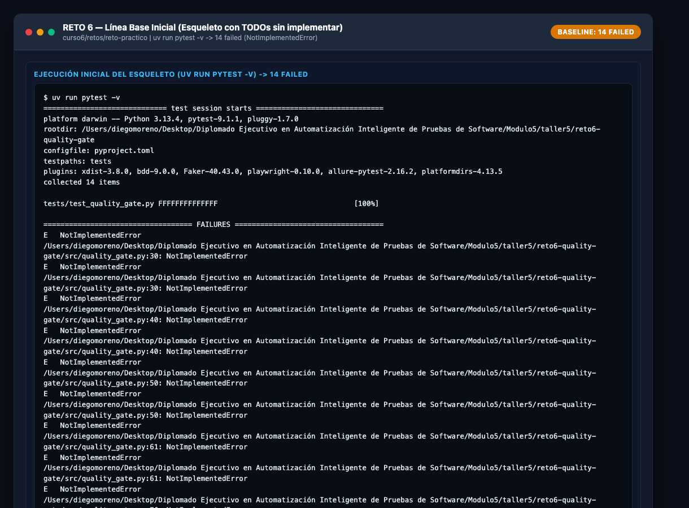
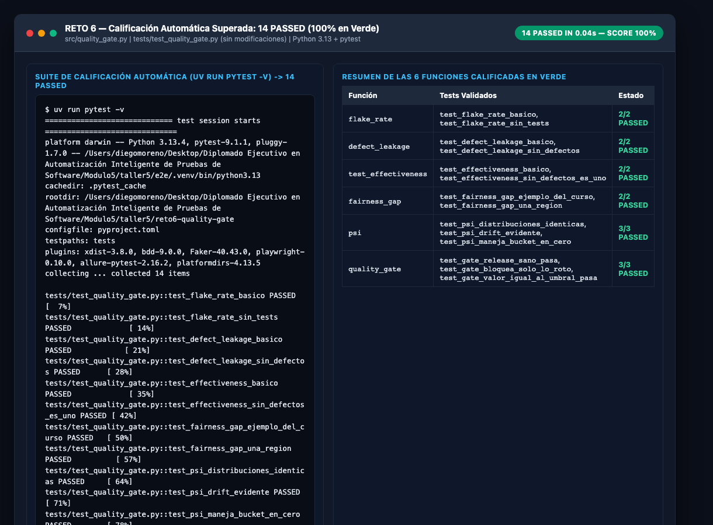
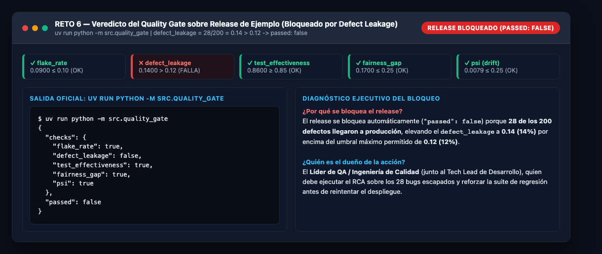

# Documento de Soporte — Reto 6: Quality Gate Unificado de Gobernanza QA y Machine Learning

- **Programa:** Diplomado Ejecutivo en Automatización Inteligente de Pruebas de Software — Módulo 5 / Taller 6
- **Autor:** Diego Moreno (`diegoamorenor-ux`)
- **Repositorio en GitHub (Integrado con Reto 5):** `https://github.com/diegoamorenor-ux/Reto5/tree/main/reto6-quality-gate`
- **Repositorio Base de Referencia:** `https://github.com/dsolisp/curso/tree/main/curso6/retos/reto-practico`
- **Fecha:** Noviembre 2026

---

## Tabla de Contenido

1. [Resumen Ejecutivo del Reto 6](#1-resumen-ejecutivo-del-reto-6)
2. [Especificación Matemática de las 6 Funciones y Umbrales](#2-especificación-matemática-de-las-6-funciones-y-umbrales)
3. [Código Fuente Implementado (`src/quality_gate.py`)](#3-código-fuente-implementado-srcquality_gatepy)
4. [Evidencia 1 — Línea Base Inicial (`14 failed`)](#4-evidencia-1--línea-base-inicial-14-failed)
5. [Evidencia 2 — Suite de Calificación en Verde (`14 passed`)](#5-evidencia-2--suite-de-calificación-en-verde-14-passed)
6. [Evidencia 3 — Salida del Quality Gate y Bloqueo del Release (`defect_leakage: false`)](#6-evidencia-3--salida-del-quality-gate-y-bloqueo-del-release-defect_leakage-false)
7. [Explicación del Bloqueo del Release y Dueño de la Acción](#7-explicación-del-bloqueo-del-release-y-dueño-de-la-acción)

---

## 1. Resumen Ejecutivo del Reto 6

En una institución financiera que opera modelos de **Machine Learning para aprobación de crédito**, un release seguro a producción exige evaluar simultáneamente dos frentes:
- **Día 1 — Gobernanza de Ingeniería de Calidad Tradicional:** Estabilidad de las pruebas automatizadas (*Flake Rate*), control de fuga de defectos a producción (*Defect Leakage*) y efectividad de contención en etapas previas (*Test Effectiveness*).
- **Día 2 — Gobernanza y Confiabilidad de Modelos ML:** Equidad algorítmica entre regiones demográficas/geográficas (*Fairness Gap*) y estabilidad en la distribución de los datos de entrada frente al entrenamiento (*Population Stability Index — PSI*).

El presente entregable implementa el módulo `src/quality_gate.py` completando las **6 funciones** requeridas utilizando exclusivamente la biblioteca estándar de Python (`math` y `json`), sin alterar los umbrales de negocio (`THRESHOLDS`) ni la suite de calificación (`tests/test_quality_gate.py`).

---

## 2. Especificación Matemática de las 6 Funciones y Umbrales

| # | Función Implementada | Definición Matemática | Caso Borde Exigido | Umbral (`THRESHOLDS`) | Regla de Aprobación (`True`) |
| :-: | :--- | :--- | :--- | :---: | :---: |
| **1** | `flake_rate(flaky_tests, total_tests)` | $\frac{\text{flaky\_tests}}{\text{total\_tests}}$ | Si `total_tests == 0` $\rightarrow$ `0.0` | `0.10` (10%) | $\text{valor} \le 0.10$ |
| **2** | `defect_leakage(prod_defects, total_defects)` | $\frac{\text{prod\_defects}}{\text{total\_defects}}$ | Si `total_defects == 0` $\rightarrow$ `0.0` | `0.12` (12%) | $\text{valor} \le 0.12$ |
| **3** | `test_effectiveness(found_in_test, total_defects)` | $\frac{\text{found\_in\_test}}{\text{total\_defects}}$ | Si `total_defects == 0` $\rightarrow$ `1.0` | `0.85` (85%) | $\text{valor} \ge 0.85$ |
| **4** | `fairness_gap(approval_rates)` | $\max(R) - \min(R)$ | Si $\text{len}(R) \le 1$ $\rightarrow$ `0.0` | `0.25` (25 pp) | $\text{valor} \le 0.25$ |
| **5** | `psi(expected_pct, actual_pct)` | $\sum_{i} (a_i - e_i) \ln\left(\frac{a_i}{e_i}\right)$ | Si $e_i = 0$ o $a_i = 0$, sustituir por `0.0001` | `0.25` | $\text{valor} \le 0.25$ |
| **6** | `quality_gate(metrics)` | Conjunción lógica $\bigwedge_{m} \text{checks}[m]$ | Valor exactamente igual al umbral **pasa** | Todos los 5 | `"passed": all(checks.values())` |

---

## 3. Código Fuente Implementado (`src/quality_gate.py`)

```python
import json
import math

# Umbrales del curso (Día 1 + Día 2)
THRESHOLDS = {
    "flake_rate": 0.10,          # falla si >
    "defect_leakage": 0.12,      # falla si >
    "test_effectiveness": 0.85,  # falla si <
    "fairness_gap": 0.25,        # falla si >
    "psi": 0.25,                 # falla si >
}


def flake_rate(flaky_tests: int, total_tests: int) -> float:
    if total_tests == 0:
        return 0.0
    return flaky_tests / total_tests


def defect_leakage(prod_defects: int, total_defects: int) -> float:
    if total_defects == 0:
        return 0.0
    return prod_defects / total_defects


def test_effectiveness(defects_found_in_test: int, total_defects: int) -> float:
    if total_defects == 0:
        return 1.0
    return defects_found_in_test / total_defects


def fairness_gap(approval_rates: dict[str, float]) -> float:
    if len(approval_rates) <= 1:
        return 0.0
    rates = approval_rates.values()
    return max(rates) - min(rates)


def psi(expected_pct: list[float], actual_pct: list[float]) -> float:
    total = 0.0
    for exp, act in zip(expected_pct, actual_pct):
        e = 0.0001 if exp == 0 else exp
        a = 0.0001 if act == 0 else act
        total += (a - e) * math.log(a / e)
    return total


def quality_gate(metrics: dict[str, float]) -> dict:
    checks = {
        "flake_rate": metrics["flake_rate"] <= THRESHOLDS["flake_rate"],
        "defect_leakage": metrics["defect_leakage"] <= THRESHOLDS["defect_leakage"],
        "test_effectiveness": metrics["test_effectiveness"] >= THRESHOLDS["test_effectiveness"],
        "fairness_gap": metrics["fairness_gap"] <= THRESHOLDS["fairness_gap"],
        "psi": metrics["psi"] <= THRESHOLDS["psi"],
    }
    return {
        "checks": checks,
        "passed": all(checks.values()),
    }
```

---

## 4. Evidencia 1 — Línea Base Inicial (`14 failed`)

Al iniciar el reto con el esqueleto sin implementar (`raise NotImplementedError`), la ejecución de `pytest -v` arroja **`14 failed`**, confirmando la línea de partida exigida en la guía:



---

## 5. Evidencia 2 — Suite de Calificación en Verde (`14 passed`)

Tras implementar las 6 funciones respetando todos los casos borde (división por cero en métricas vacías, lista con 0 o 1 región en `fairness_gap`, buckets en `0.0` reemplazados por `0.0001` en `psi` y valores exactamente sobre la frontera en `quality_gate`), la suite completa pasa al **100% (`14 passed in 0.04s`)**:



---

## 6. Evidencia 3 — Salida del Quality Gate y Bloqueo del Release (`defect_leakage: false`)

Al evaluar el release de ejemplo mediante `uv run python -m src.quality_gate`:

| Indicador del Release de Ejemplo | Datos de Entrada | Valor Calculado | Umbral Exigido | Estado (`check`) |
| :--- | :--- | :---: | :---: | :---: |
| **`flake_rate`** | `18` flaky de `200` tests | **`0.0900`** (9.0%) | $\le 0.10$ (10%) | `true` (PASA) |
| **`defect_leakage`** | `28` bugs en prod de `200` totales | **`0.1400`** (14.0%) | $\le 0.12$ (12%) | **`false` (BLOQUEA)** |
| **`test_effectiveness`** | `172` detectados en QA de `200` | **`0.8600`** (86.0%) | $\ge 0.85$ (85%) | `true` (PASA) |
| **`fairness_gap`** | `north: 0.78`, `south: 0.61`, `east: 0.70`, `west: 0.66` | **`0.1700`** (17.0 pp) | $\le 0.25$ (25 pp) | `true` (PASA) |
| **`psi`** | Esperado `[0.25]*4` vs Actual `[0.22, 0.24, 0.27, 0.27]` | **`0.0079`** | $\le 0.25$ | `true` (PASA) |

### Salida JSON Exacta Obtenida

```json
{
  "checks": {
    "flake_rate": true,
    "defect_leakage": false,
    "test_effectiveness": true,
    "fairness_gap": true,
    "psi": true
  },
  "passed": false
}
```



---

## 7. Explicación del Bloqueo del Release y Dueño de la Acción

> **Frase de Diagnóstico Ejecutivo (Por qué se bloquea y quién es el dueño):**  
> **El release se bloquea automáticamente (`"passed": false`) porque el indicador `defect_leakage` alcanzó `0.14` (28 defectos filtrados a producción de 200 totales = 14%), superando el umbral máximo tolerado por el banco de `0.12` (12%), y el dueño directo de ejecutar la acción correctiva es el Líder de QA / Ingeniería de Calidad (en conjunto con el Tech Lead de Desarrollo), quien debe realizar el análisis de causa raíz (*Root Cause Analysis*) sobre los 28 defectos escapados y agregar las pruebas de regresión/integración faltantes antes de volver a presentar el release al Quality Gate.**
